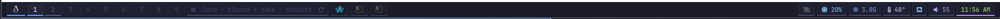
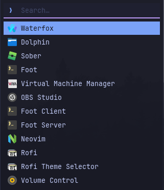
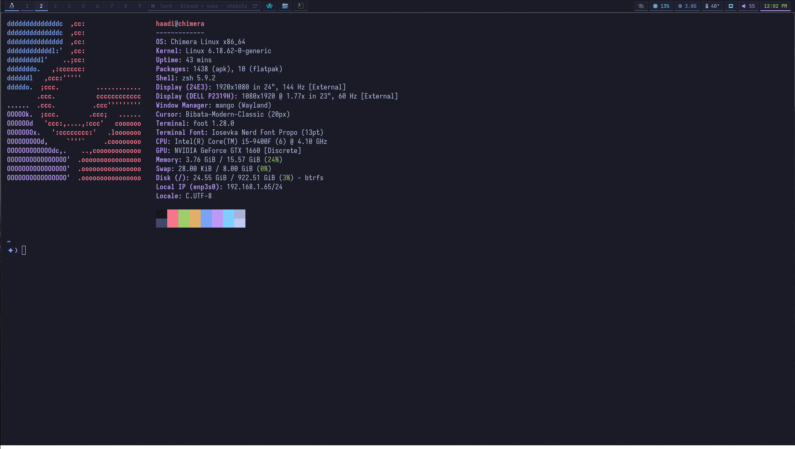
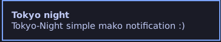

# tokyo-dotfiles

mangowm + Tokyo Night. Waybar, mako, rofi, and foot, this is a personal repo, use if you wish, but it might be broken for you lol. btw the apps on waybar are active apps, not pinned, click on them and go to them!, also read the files and see what they do, SUPER+scroll allows you to change your workspaces

## Pics









## What's in here

| Dir      | App                                   |
| -------- | ------------------------------------- |
| `waybar/`| status bar                            |
| `mako/`  | notifications                         |
| `mango/` | mangowm (`config.conf`, binds, autostart) |
| `foot/`  | terminal (`foot.ini`)                 |
| `rofi/`  | launcher (`styles.rasi`, scripts)     |

double click left whats played on waybar for repeat, right click for next, middle click for previous, left click for pause, SUPER+scroll can change workspaces, ALT+\ allows for floating windows, etc. look into code for more info!
also mv the keyview file and chmod +x it, update the autostart.conf with that path if needed

## Install

```sh
git clone https://github.com/sudopacmanopsec/tokyo-dotfiles.git ~/tokyo-dotfiles
cd ~/tokyo-dotfiles
./install.sh
```

`install.sh` copies each folder into `~/.config` and keeps a numbered backup
(`file.~1~`) of anything it replaces. It does not touch `~/.zshrc`, so that is
the manual `cp` line above. **Read "Before you install" first.**

## Dependencies

### Required

| What                    | reason                                      |
| ----------------------- | ------------------------------------------- |
| mangowm (+ wlroots 0.19, scenefx) | the compositor                    |
| waybar **0.14+**        | needs the `ext/workspaces` module           |
| mako                    | notifications                               |
| foot                    | terminal                                    |
| rofi                    | launcher                                    |
| playerctl               | media pill and its click actions            |
| pavucontrol             | volume click action                         |
| PipeWire or PulseAudio  | provides `pactl` for the volume module      |
| grim, slurp             | screenshots                                 |
| gtk4 py3-gobject        | keyview lol                                 |
| starship                | prompt                                      |
| JetBrains Mono          | waybar and rofi                             |
| Iosevka                 | foot                                        |
| Nerd Font symbols       | icon glyphs in the bar, rofi and foot       |
| Papirus icon theme      | rofi icons                                  |

**Don't install:**

- Both `pulseaudio` and `pipewire-pulse`. They conflict, pick one.

## Before you install (so nothing breaks)

**1. Back up what you have.**

```sh
mkdir -p ~/config-backup
cp -r ~/.config/{waybar,mako,mango,foot,rofi} ~/config-backup/ 2>/dev/null
cp ~/.zshrc ~/config-backup/ 2>/dev/null
```

**2. Fonts first.** If the fonts below are missing, the bar shows empty boxes
instead of icons. After installing them, run `fc-cache -fv` and check with
`fc-list | grep -iE "jetbrains|iosevka|symbols"`.

**3. After installing, change these to match your machine.**

- **Paths and username.** Search the mango files and `rofi/scripts/` for
  `/home/`, which points at another user's home. Replace it with yours.
- **Autostart and binds.** Every command launched from
  `mango/autostart.conf` and `mango/bind.conf` has to be installed. A bind that
  launches a missing app does nothing, with no error.
- **Display settings.** Monitor names, scale and refresh rate in
  `mango/config.conf` are specific to one machine. Check yours and update them.
  The same goes for keyboard layout and touchpad settings.
- **Wallpaper script.** Open `rofi/scripts/wallpaper.sh` and check which
  wallpaper tool it calls, then install that tool and point the script at your
  wallpaper folder.
- **Logo.** `waybar/config.jsonc` has a distro logo glyph in the `custom/void`
  block. Use `\uf32e` for Void or `\uf30d` for Gentoo.
- **Volume mute action.** If the config calls `pamixer -t` and you don't have
  `pamixer`, change it to `pactl set-sink-mute @DEFAULT_SINK@ toggle`.
- **Fonts by name.** If you installed plain fonts instead of the patched Nerd
  Font versions, change the font names in `waybar/style.css`,
  `rofi/styles.rasi` and the `font=` line in `foot/foot.ini` to the families
  you have, and add `Symbols Nerd Font` as a fallback.
- **Desktops.** The battery pill hides itself without a battery, and the
  bluetooth pill hides without a controller. Nothing to change.

**4. Check each piece after the first login.**

```sh
waybar                        # run in a terminal to see any errors
rofi -show drun               # prints theme errors if the theme is broken
notify-send "test" "hello"    # tests mako
fc-list | grep -i nerd        # confirms icon fonts
```
